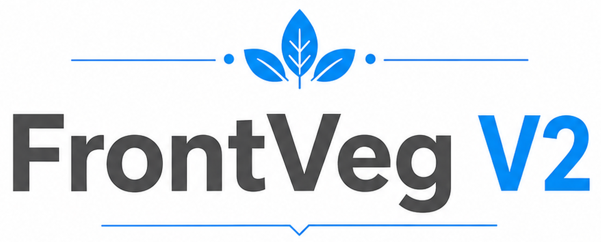

# FrontVeg V2 : Foreground-Aware Zero-Shot Plant Trait Segmentation in Trellised Crops  

<!-- ## Authors -->
**Abdoul Djalil Ousseini Hamza** ([ORCID](https://orcid.org/0009-0008-6172-4439)), **Herearii Metuarea** ([ORCID](https://orcid.org/0009-0008-2716-0617)), **Corentin Lothodé** ([ORCID](https://orcid.org/0000-0002-8209-317X)), **Morgane Roth** ([ORCID](https://orcid.org/0000-0002-5244-4215)), **Eric Duchêne** ([ORCID](https://orcid.org/0000-0003-2712-1892)), **Lionel Ley**, **David Alletru** ([ORCID](https://orcid.org/0009-0006-6238-6123)), and **David Rousseau**<sup>*</sup> ([ORCID](https://orcid.org/0000-0002-7935-1609))

*\* Project Supervisor* 


[](https://napari-hub.org/plugins/frontvegv2.html) [](https://www.python.org/downloads/) 
[](https://pytorch.org/)
[](https://opensource.org/licenses/MIT)
[](https://github.com/djaliloh/FrontVegV2) 


A napari plugin and a batch processing pipeline for automated plant organ segmentation and leaf area estimation in trellised crops using side view monocular RGB images.

Some examples of organ segmentation on different trellised crops: 

<p align="center">
  
</p>

---

## Prerequisites

1. **Create and activate a virtual environment** 

We recommend using Python 3.10 and cuda 12.1:

   ```bash
   conda create -n <env_name> python=3.10 -y
   conda activate <env_name>
   pip install torch torchvision --index-url https://download.pytorch.org/whl/cu121
   ```

2. **Request SAM3 Weights Access:**
   Request access to the SAM3 checkpoint on [Hugging Face](https://huggingface.co/facebook/sam3). Once approved, download `sam3.pt`.

3. **Download Depth-Anything V2 Weights:**
   Download the Large model checkpoint (`depth_anything_v2_vitl.pth`) from the official [Depth-Anything V2 repository](https://github.com/DepthAnything/Depth-Anything-V2).

4. **Once you have cloned the repo, place your downloaded checkpoints inside the following folders:** 
   - Place (`sam3.pt`) into: `checkpoints/sam3_ckpts/` (if not exist, create it)
   - Place (`depth_anything_v2_vitl.pth`) into: `checkpoints/depthanything_ckpts/` (if not exist, create it)

---

## Installation

### Option 1: Batch processing (Git Clone + Editable Install)

#### 1. Clone the FrontVeg V2 repository 
```bash 
git clone https://github.com/djaliloh/FrontVegV2.git
cd FrontVegV2
```

#### 2. Create the external directory
```bash
mkdir external
cd external
```

#### 3. Clone and install the third-party models in the `external/` folder:
```bash
# Clone Depth-Anything V2 (no need to install)
git clone https://github.com/DepthAnything/Depth-Anything-V2.git

# Clone and install SAM3
git clone https://github.com/facebookresearch/sam3.git
cd sam3
pip install -e .
cd ../..
```

#### 4. Install FrontVeg V2 in editable mode 
```bash
pip install -e .
```

#### 5. Run the pipeline for batch processing 
```bash
python main_final.py --input <path_to_raw_rgb_images> --output <path_to_final_output_directory> --sam3_ckpt <path_to_sam3.pt> --prompt <sam3_text_prompt>  --peak_dist <integer>  --sigma <float> --smoothed
```


### Option 2: A standalone napari plugin (PyPI Install) 

#### 1. Create directories for FrontVeg V2 and the external dependencies

```bash
# create directory for FrontVegV2 if you don't have one
mkdir FrontVegV2
cd FrontVegV2

# create directory for external dependencies
mkdir external
cd external
```

#### 2. Clone and install external models in the `external/` folder

```bash
# Clone Depth-Anything V2 (no need to install)
git clone https://github.com/DepthAnything/Depth-Anything-V2.git
```


```bash
#  Clone and install SAM3
git clone https://github.com/facebookresearch/sam3.git
cd sam3
pip install -e .
cd ../..
```

#### 3. Install FrontVeg V2 from PyPI

```bash
pip install frontvegV2
# This installs the FrontVeg V2 package and its Python dependencies.
```

#### 4. Check the installation

```bash
# You can verify that FrontVeg V2 is available with:
python -c "import frontveg; print('FrontVeg V2 installed successfully')"
```

> **Important:** The external repositories must be installed before running FrontVeg V2. In particular, **SAM3 must be installed with `pip install -e .`** from its cloned repository.

#### 5. Usage in Napari

5.1. Launch Napari: `napari` <br>
5.2. Open an RGB image of a row crop. <br>
5.3. Select **Plugins > FrontVeg V2 Studio**. <br>
5.4. Set your prompt (e.g., "leaf") and adjust parameters (Tile Overlap, Sigma, etc.). <br>
5.5. Click **Run Complete Pipeline**.

> **Watch the [FrontVeg V2 napari plugin tutorial here](https://youtu.be/0sHq0k9mMcc)**


## To reproduce results from the paper

### 1. Dataset

We provide 1 image and its corresponding mask of each crop used in this study to test the pipeline: <br>
Find the data here: https://github.com/djaliloh/FrontVegV2/tree/main/frontvegv2_data

> The entire dataset used in the paper will be available on [Zenodo](https://zenodo.org/) upon acceptance. 

### 2. Evaluation

Assuming you have set up the environment and cloned the FrontVegV2 and external <br> 
models repositories, you can run the pipeline with the following parameters:

```text
**Parameters used to obtain the results presented in the paper:**
   - VADT params:
      - peak_dist=8        # peak distance
      - sigma=1.1          # sigma
      - smoothed           # if flag is present, apply gaussian smoothing to the depth map

   - SAM3 params:
      - conf_threshold = 0.35  # confidence threshold
      - overlap        = 0.50  # overlap between tiles
      - max_tile_ratio = 0.55  # max tile ratio
      - tile_size      = 640   # tile size
```

```bash
# Run the pipeline with your desired parameters
python main_final.py \
  --input <path_to_raw_rgb_images> \
  --output <path_to_final_output_directory> \
  --sam3_ckpt <path_to_sam3.pt> \
  --prompt <sam3_text_prompt> \
  --peak_dist <integer> \
  --sigma <float> \
  --smoothed 
```


## Acknowledgements

This work was supported by the French **Programme et Équipements Prioritaires de Recherche (PEPR) AgroEcoNum** ([pepr-agroeconum.fr](https://www.pepr-agroeconum.fr/)), the **France 2030** program through the Agence Nationale de la Recherche (ANR), and the European Union’s **Horizon Europe** research and innovation programme (Grant No. 101094587, **PHENET**). 

This research used computing resources from the **GLiCID Computing Facility** (Ligerien Group for Intensive Distributed Computing, [doi:10.60487/glicid](https://doi.org/10.60487/glicid), Pays de la Loire, France), as well as HPC and storage resources provided by **GENCI at IDRIS** on the Jean Zay supercomputer’s H100 partition (Grant 2025-AD010115553R1).

The authors would like to thank **Sirine Gharbi**, **Oumaima Karia**, **Justin Langlois**, **Paul Persello**, and **Thomas Lebouc** for their valuable assistance in annotating the image dataset used in this study.


## Contact

Imhorphen team, bioimaging research group, <br> 
IRHS, UMR 1345, INRAE, <br>
42 Rue Georges Morel, 49070 Beaucouzé, France

- David Rousseau - Professor, david.rousseau@univ-angers.fr
- Corentin Lothode - Researcher Engineer, corentin.lothode@inrae.fr
- Herearii Metuarea - PhD student, herearii.metuarea@univ-angers.fr
- Abdoul Djalil Ousseini Hamza - Engineer, abdoul-djalil.ousseini-hamza@inrae.fr


## Troubleshooting

- Missing Module 'triton': On Windows, install the Windows-compatible Triton build: pip install triton-windows.
- RuntimeError: mat1 and mat2 must have the same dtype: If running on GPUs older than NVIDIA Ampere (e.g., GTX 10xx, RTX 20xx), ensure autocast is set to float16 or float32 instead of bfloat16.
- Missing Checkpoints Error: Verify that sam3.pt exists at the expected path or set FRONTVEG_SAM3_CKPT manually.


## License

FrontVeg V2 is released under the `MIT License`. See the `LICENSE.txt` file for details.

Third-party software and models used by FrontVeg V2, including SAM3 and
Depth Anything V2, are subject to their respective licenses and terms.


## Contributing

Contributions, bug reports, feature requests, and suggestions are welcome.

To contribute:

1. Fork the repository.
2. Create a new branch for your changes.
3. Make your changes and test them locally.
4. Commit your changes with a clear and descriptive message.
5. Open a pull request describing your changes and their purpose.

For bugs or feature requests, please open an issue and provide enough information to reproduce the problem or evaluate the proposed feature.

By contributing to this repository, you agree that your contributions will be distributed under the same license as the project.


## Citing FrontVeg V2
> **Note:** The SoftwareX paper citation will be available soon.

```bibtex
@inproceedings{
hamza2026foregroundaware,
title={Foreground-Aware Zero-Shot Plant Trait Segmentation in Trellised Crops Using Side View Monocular {RGB} Images},
author={Abdoul Djalil Ousseini Hamza and Herearii Metuarea and Corentin Lothodé and Morgane Roth and Eric Duchêne and Lionel LEY and David Allétru and David Marc ROUSSEAU},
booktitle={11th Workshop on Computer Vision in Plant Phenotyping and Agriculture},
year={2026},
url={https://openreview.net/forum?id=Z24CpPVqcU}  
}
```


<!-- 1. **Tomato** (Variety: `B_564_2_34140`)  
   - **Category:** Trellised High-wire (High-density vertical training)  
   - **Growth Stage:** 4th truss  
   - **Images:** High-resolution images taken from a side-view robotic gantry system.  
   - **Data Location:** `https://github.com/djaliloh/FrontVegV2_data`

2. **Winter Squash** (Variety: `T_189_5_49095`)  
   - **Category:** Trellised Vertical (Vertical training, dense canopy, fruit visible)  
   - **Growth Stage:** 1st to 7th truss  
   - **Images:** High-resolution images taken from a side-view robotic gantry system.  
   - **Data Location:** `https://github.com/djaliloh/FrontVegV2_data` -->


<!-- ```powershell
# If you installed the plugin directly via PyPI (pip install frontvegv2), you must specify the paths to your local SAM3 code repository and checkpoints using environment variables : 

# Windows (PowerShell):
$env:FRONTVEG_SAM3_REPO = "<path_to_sam3_repo>"
$env:FRONTVEG_SAM3_CKPT = "<path_to_sam3.pt>"
$env:FRONTVEG_DEPTH_REPO = "<path_to_depth_anything_v2_repo>"
$env:FRONTVEG_DEPTH_CKPT_DIR = "<path_to_depth_ckpts_folder>"

napari


# Linux / macOS (Bash):
export FRONTVEG_SAM3_REPO="<path_to_sam3_repo>"
export FRONTVEG_SAM3_CKPT="<path_to_sam3.pt>"
export FRONTVEG_DEPTH_REPO="<path_to_depth_anything_v2_repo>"
export FRONTVEG_DEPTH_CKPT_DIR="<path_to_depth_ckpts_folder>"

napari
``` -->

<!-- or visit the website https://frontvegv2.github.io/FrontVegV2/.  -->