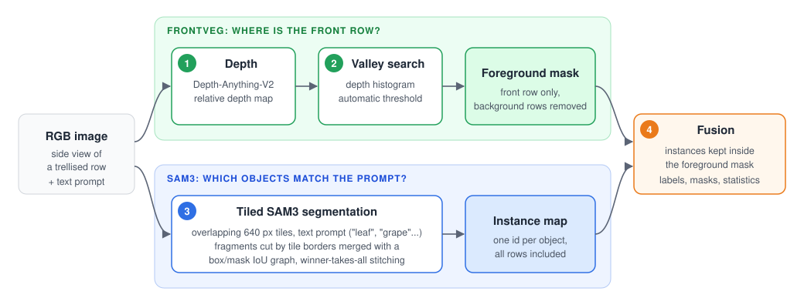
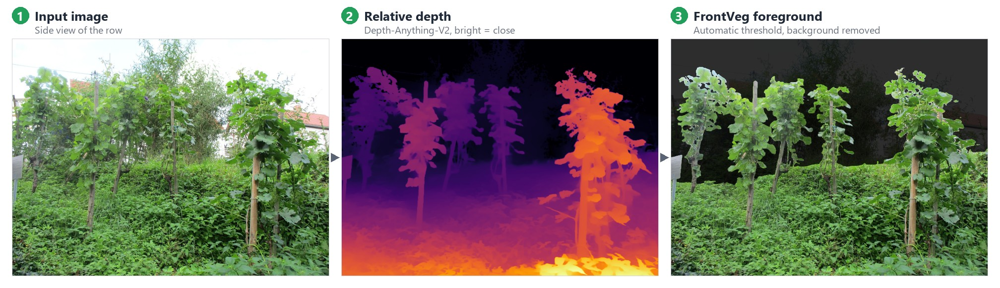
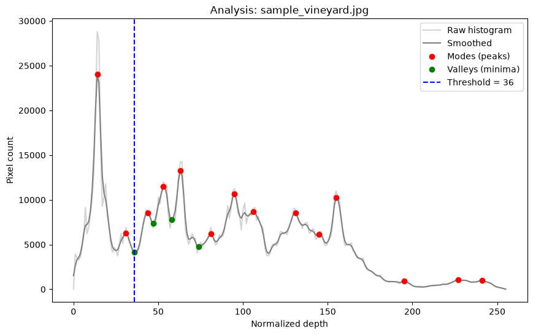
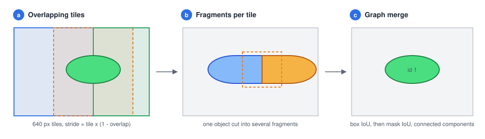

# How it works

FrontVeg V2 answers two questions for every pixel: *is it on the front row?* (FrontVeg) and *does it belong to an object matching the prompt?* (SAM3). The final result keeps only the objects that satisfy both.

## 1. Depth estimation

[Depth-Anything-V2](https://github.com/DepthAnything/Depth-Anything-V2) (ViT-L encoder) predicts a relative depth map from the single RGB image. No stereo camera or calibration is needed. The map is normalized to `[0, 255]`, bright values being close to the camera.

## 2. Foreground thresholding

In a side view of a trellised crop, depth values form clusters: the front row, the inter-row space, the next rows and the background. FrontVeg looks for the gap between these clusters:

1. The depth histogram is computed, ignoring zero-depth pixels, then smoothed with a Gaussian filter (`sigma`).
2. Its peaks (depth modes) are detected; `peak_dist` sets the minimal distance between two peaks.
3. Valleys are searched between consecutive peaks, from the second peak onwards, among the first four valleys.
4. The lowest valley becomes the threshold; pixels closer than the threshold form the **foreground mask**.

The diagnostic plot below is produced for every image by the batch tools (`graphics/` folder):

If fewer than three peaks are found, FrontVeg falls back to the middle of the depth range (127) and reports it, both in napari and in the batch logs.

In batch mode, all depth maps of a folder are normalized with the same reference maximum so that images of the same acquisition are thresholded consistently.

## 3. Tiled SAM3 segmentation

[SAM3](https://github.com/facebookresearch/sam3) segments every object matching a short text prompt. High-resolution field images contain hundreds of small organs, so the image is processed in overlapping tiles:

1. **Tiles.** The image is split into 640 px tiles with the chosen overlap. The last tile of each row and column is aligned to the image border.
2. **Fragments.** SAM3 runs on each tile. Masks smaller than 50 px or covering more than 55 % of their tile (usually hallucinations) are discarded.
3. **Merge.** Fragments of the same object, cut by tile borders, are linked when their boxes overlap (IoU > 0.05) and their masks overlap (IoU > 0.10). Connected components of this graph become objects.
4. **Stitching.** Each pixel is assigned to the highest-scoring fragment covering it.

## 4. Fusion

The SAM3 instance map is intersected with the FrontVeg foreground mask: objects, or parts of objects, located behind the front row are removed. The result is a labels image (one id per object), a binary mask and per-object areas in pixels.

## Ablation baselines

`frontveg.core` also contains the baselines used in the paper's ablation study:

| Module | Strategy |
|---|---|
| `sam3_full_inference.SAM3FullImageInference` | Single SAM3 pass on the full image (baselines A and C) |
| `sam3_standard_tiler.SAM3StandardTiledInference` | Tiling with greedy box-IoU NMS (baselines B and D) |
| `nms_processor.NMSProcessor` | Area-based cleanup after NMS (baselines B and D) |

The figures of this page were produced with FrontVeg V2 on a public domain image ([source](https://commons.wikimedia.org/wiki/File:20210715Rebenberg_Eschringen2.jpg), CC0, AnRo0002).
