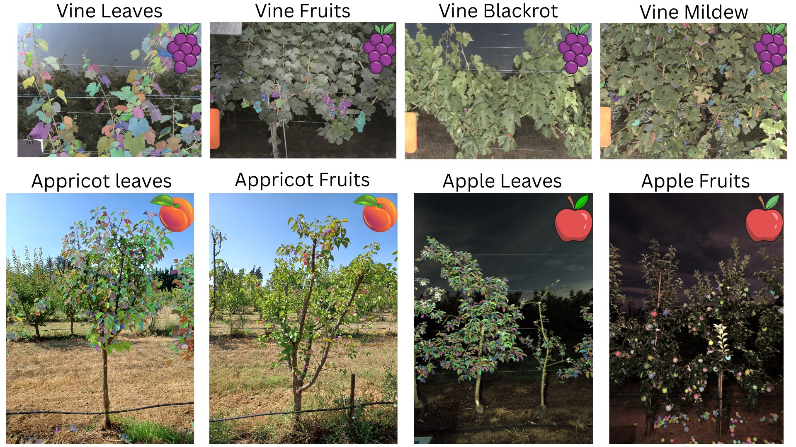

# FrontVeg V2 documentation

FrontVeg V2 segments plant organs (leaves, bunches, fruits) of the **front row** of trellised crops from a single side-view RGB image, without training. It combines monocular depth estimation (Depth-Anything-V2) to isolate the front row with text-prompted segmentation (SAM3) to detect each organ.

## Get started

| | Guide | You will |
|---|---|---|
| 1 | [Installation](installation.md) | Set up the environment, the models and the checkpoints |
| 2 | [napari plugin](napari-guide.md) | Segment an image interactively in five steps |
| 3 | [Batch processing](batch-processing.md) | Process folders from the command line or from Python |

## Learn more

- [How it works](how-it-works.md): depth thresholding, tiled SAM3, fusion.
- [Parameters](parameters.md): defaults and tuning guide.
- [Troubleshooting](troubleshooting.md): common errors and fixes.
- [Contributing](https://github.com/djaliloh/FrontVegV2/blob/main/CONTRIBUTING.md): development setup, tests and conventions.
