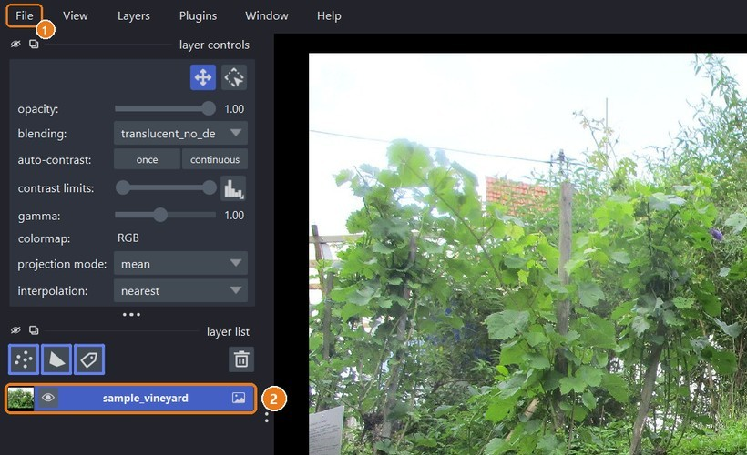
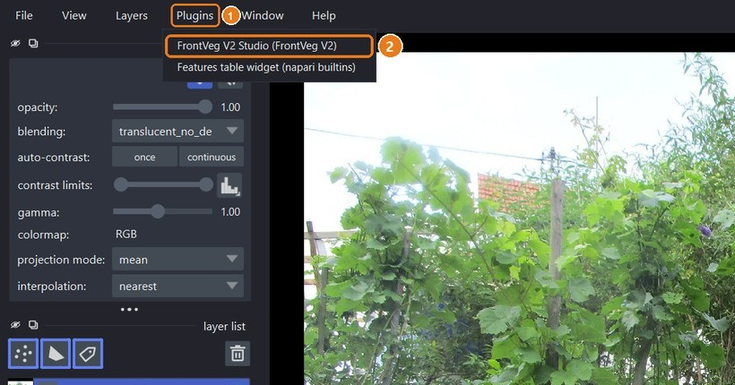
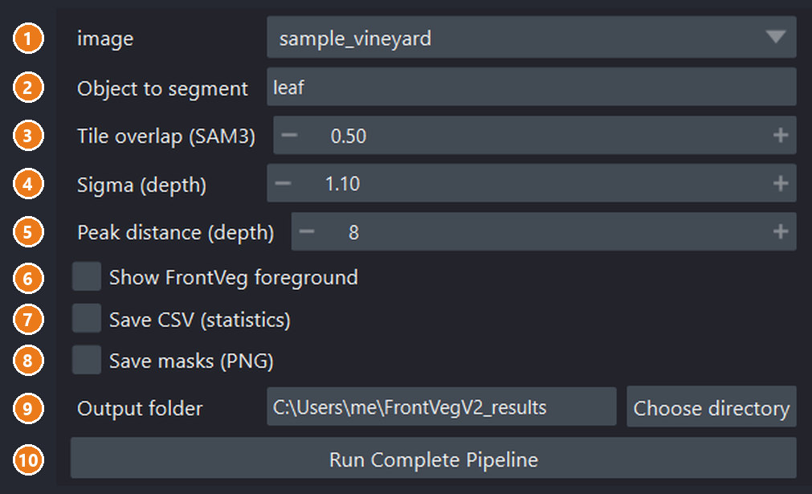
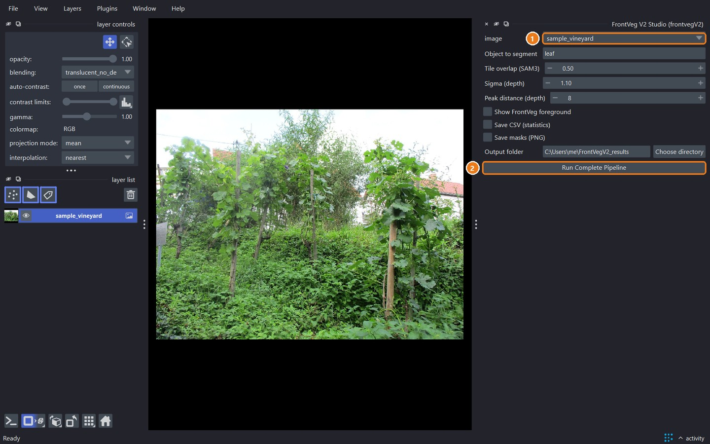
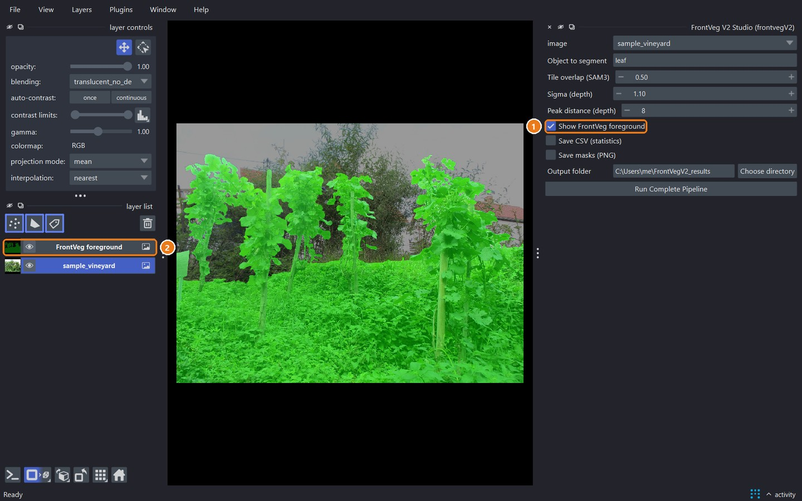

# napari plugin guide

Segment the organs of the front crop row of one image, interactively, in five steps.

> [!NOTE]
> Complete the [installation](installation.md) first. The first run loads the models, which can take a minute; the following runs reuse them.

## Step 1. Open an image

Launch napari from your environment:

```bash
napari
```



1. Select **File > Open File(s)...** and choose an RGB image of the crop row, or drag and drop the file onto the window.
2. The image appears in the **layer list**.

Supported images: PNG, JPEG, TIFF and BMP, in color or grayscale, 8 or 16 bits. RAW files can be opened through a napari reader plugin; the batch tools read them directly (see [batch processing](batch-processing.md)).

> [!TIP]
> Best results are obtained with a **side view** facing the row, the camera roughly parallel to the canopy, with other rows or the landscape in the background.

## Step 2. Open FrontVeg V2 Studio



1. Open the **Plugins** menu.
2. Select **FrontVeg V2 Studio (FrontVeg V2)**. The panel docks on the right of the window.

## Step 3. Set the parameters



| # | Field | Description | Default |
|---|---|---|---|
| 1 | **image** | Image layer to process. | Active layer |
| 2 | **Object to segment** | SAM3 text prompt, in English: `leaf`, `grape`, `apple`, `fruit`... | `leaf` |
| 3 | **Tile overlap (SAM3)** | Overlap between the 640 px tiles. Higher values merge objects cut by tile borders more reliably but take longer. | 0.50 |
| 4 | **Sigma (depth)** | Smoothing of the depth histogram. Increase it if the foreground is fragmented. | 1.10 |
| 5 | **Peak distance (depth)** | Minimal distance between depth modes, in histogram bins. Increase it if background rows are kept. | 8 |
| 6 | **Show FrontVeg foreground** | Adds the foreground mask as a green overlay, to check the depth step. | Off |
| 7 | **Save CSV (statistics)** | Writes one row per detected object. | Off |
| 8 | **Save masks (PNG)** | Writes the binary mask and the color-coded instance mask. | Off |
| 9 | **Output folder** | Where CSV and PNG files are written. | `~/FrontVegV2_results` |
| 10 | **Run Complete Pipeline** | Starts the processing. | |

See [parameters](parameters.md) for tuning advice.

## Step 4. Run the pipeline



1. Check that the right image is selected.
2. Click **Run Complete Pipeline**.

The button shows **Running...** while the image is processed in the background: napari stays responsive and progress messages appear at the bottom right. A summary is displayed when processing ends, in the form `leaf: <count> instance(s), mean area <mean> px (std <std> px), <duration> s`.

## Step 5. Review the results



The plugin adds up to two layers:

| Layer | Content |
|---|---|
| `Result_<prompt>` | Labels layer, one color per detected object. Hover an object to read its id. |
| `FrontVeg foreground` | Green overlay of the front row, dimming the removed background (when option 6 is checked). |

1. With **Show FrontVeg foreground** checked, verify that the green area covers the front row only.
2. Toggle the eye icon of each layer to compare the result with the original image.

Running the pipeline again with other parameters updates these layers instead of adding new ones.

Example results on different crops and organs:


## Exported files

With options 7 and 8, the output folder contains, for an image `plot_1` and the prompt `leaf`:

| File | Content |
|---|---|
| `plot_1_leaf_stats.csv` | One row per object: `ID_Instance`, `Count`, `Total_Area_Pixels`, `Surface_Pixels` (object area), `Prompt`, `Sigma`, `Peak_Dist`, `Tile_Overlap` |
| `plot_1_leaf_mask_binary.png` | Binary mask, white = segmented objects |
| `plot_1_leaf_mask_colored.png` | One color per object, black background |

`ID_Instance` matches the label displayed in napari. Areas are in pixels.

Something went wrong? See [troubleshooting](troubleshooting.md).
